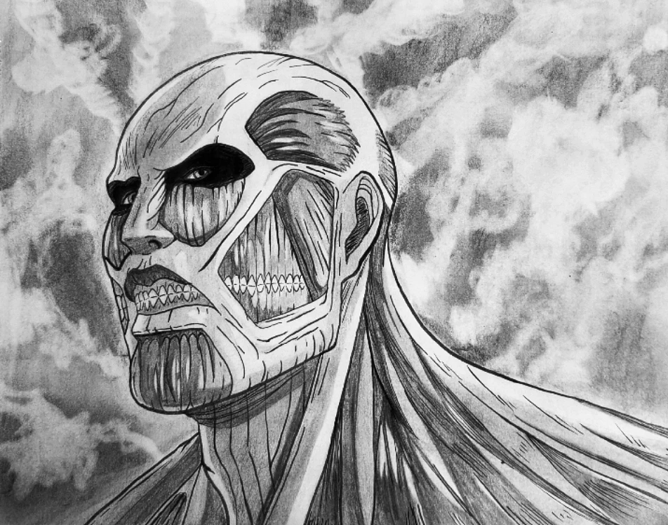

<h1 align="center">Kizuna</h1>

<b>One launcher for all our modded Minecraft servers.</b> 
Sign in with Microsoft, pick a server, press Play. Kizuna installs Minecraft, Java, mods and updates for you.

  <a href="https://pglol.github.io/minecraft/"><b>Website</b></a> ·
  <a href="https://github.com/pglol/minecraft/releases/latest"><b>Download</b></a> ·
  <a href="https://pglol.github.io/minecraft/privacy.html">Privacy</a>

## Servers

<table>
<tr>
<td width="50%" valign="top">

<h3><a href="https://pglol.github.io/minecraft/servers/aot.html">Attack on Titan RPG</a></h3>
Open world. Titans. Extraction runs. 
Builds: Public · Early Access · Development
</td>
<td width="50%" valign="top">
<h3><a href="https://pglol.github.io/minecraft/servers/kata.html">Kata</a></h3>
Martial arts duels in a ruined kingdom. 
Coming soon
</td>
</tr>
</table>

## How to play

1. [Download Kizuna](https://github.com/pglol/minecraft/releases/latest) and install it.
2. Sign in with the Microsoft account you play Minecraft on.
3. Pick a server and press **Play**.

---

For the team: the launcher is in <code>launcher/</code>, servers and packs in <code>servers/</code>, <code>pack/</code> and <code>packs/</code>,
the AoT RPG mod in <code>rpg-mod/</code>, the website in <code>site/</code>.
The AoT world generator's guide is in <a href="docs/aot-world-generator.md">docs/aot-world-generator.md</a>.
Not affiliated with Mojang or Microsoft.
